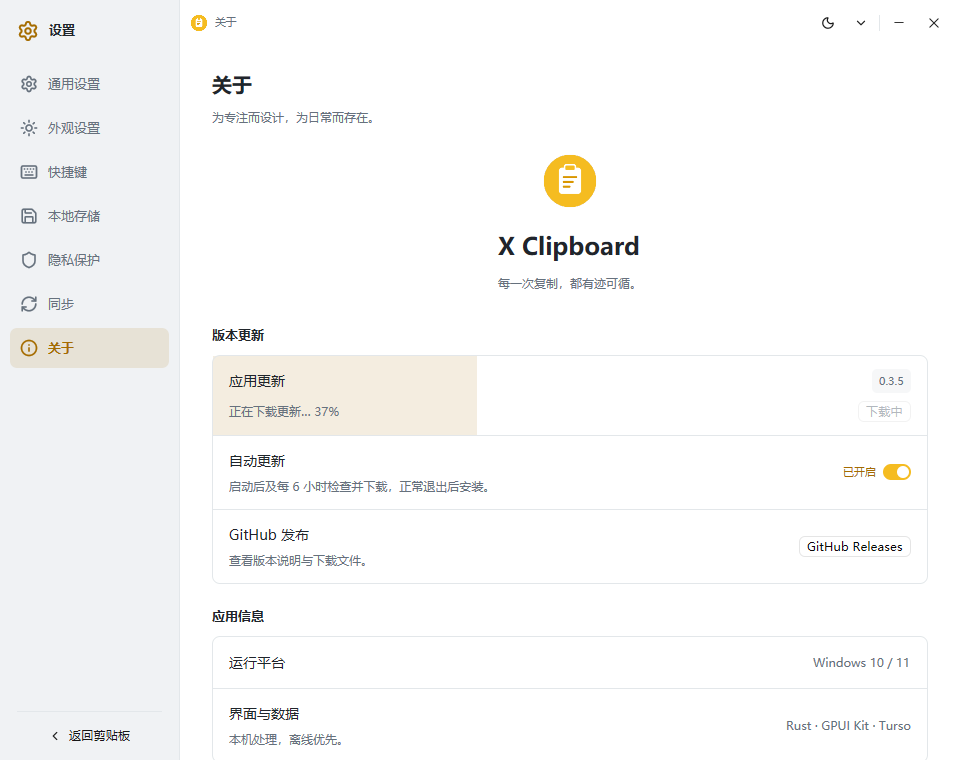

# Update acceleration and window header validation / 更新加速与窗口头部验证

2026-10-26 (Asia/Shanghai)

## Download policy / 下载策略

Version metadata and expected SHA-256 still come directly from this project's official GitHub API. The package URL is still required to exactly match this repository's release/tag/asset path. Mirror URLs are created only for that public package; account credentials, WebDAV settings, and clipboard data are not sent. HTTPS-only transport and the existing size limit, extraction whitelist, backup and rollback remain unchanged.

Candidates: GitHub direct, GHFast (`https://ghfast.top/`), GHProxy.net (`https://ghproxy.net/`), GH-Proxy (`https://gh-proxy.com/`). Provider formats were checked against the [GHFast site](https://ghfast.top/), [GHProxy.net site](https://ghproxy.net/), and [GH-Proxy official usage documentation](https://gh-proxy.com/docs/github-accelerator).

Before each download, four concurrent probes request at most the first 64 KiB using a byte Range and a five-second overall deadline. A matching Content-Range/total is required for 206; a 200 response that ignores Range is allowed only with a matching declared size, if present. Responses must have a ZIP prefix. Body sampling includes latency, so the resulting ranking is a bounded estimate of current speed, not a guarantee of whole-file throughput. Cold caches and changing routes can alter results. Failed probes are ranked after working probes, but may still be attempted if all preferred downloads fail.

Each candidate download has a bounded total request deadline, reads fixed-size chunks, and is rejected on extra bytes, incomplete content, wrong size or wrong GitHub SHA-256. Failures silently move to the next candidate. A corrupt fast mirror cannot bypass verification. No source selector is exposed. GitHub API failures are not bypassed using untrusted mirrored metadata.

Download callbacks publish actual received/expected byte counts, throttled to about 100 ms, plus preparing/downloading/verifying phases. A retry resets the current attempt's progress. The update row fills its own clipped background from 0 to 100%; the current version is positioned at its top-right. Other settings rows are not filled. State updates apply equally to manual and automatic downloads.

## Automated checks / 自动化验证

- `cargo test --locked --no-default-features --lib`: 44 passed, 3 opt-in probes ignored.
- Rustfmt, all-target ui-capture Clippy with warnings denied, and optimized Release binaries passed.
- Local real HTTP fixture: faster corrupt source was selected first, rejected by digest, then a slower valid source succeeded. Progress reset and actual nonzero bytes were asserted.
- All-corrupt candidates fail closed; missing GitHub digest is rejected before probing. Unavailable probes do not block a working source. Truncated and overlong bodies without Content-Length are rejected.
- Explicit ignored `updater::sources::tests::live_accelerated_download` passed against real v0.3.4 assets. It checked all four candidate sources and verified complete 17,191,405-byte payloads through GH-Proxy and GHFast, then completed an automatically ranked verified download. GHProxy.net returned a valid bounded sample. Initial cold-cache probes sometimes timed out; later probes succeeded, which is why failed candidates are retained for fallback.

## Native UI / 原生界面

- Marked synthetic fixture only; the ui-capture-only progress injector feeds the same updater state/revision mechanism used by real download callbacks.
- 0%, 37%, and 100% Chinese light/dark captures: `native-screenshots/update-v035-0`, `update-v035-37`, `update-v035-100`. Representative 37% light and 100% dark captures visually inspected for the version position, clipping, readability and fill width.
- English 37% light/dark captures are in `native-screenshots/update-v035-en`; dark capture inspected. Update-card labels and progress messages cover all nine bundled languages.
- History and Settings logo headers reuse the existing `WindowControlArea::Drag`. The native probe dispatches mouse hover to the GPUI hit-test map, then queries Windows WM_NCHITTEST at DPI-scaled logo and navigation positions. Both logo regions returned HTCAPTION and navigation remained HTCLIENT. Result: `test-data/logo-drag-v035-final/logo-drag-result.json`.
- This verifies the native caption hit-test contract, not physical mouse dragging across all monitors/DPI configurations. No real user window is clicked by the logo probe.

## Packaged installer / 最终安装包

Actual custom-path install, overwrite upgrade, packaged payload integrity, and uninstall passed. The synthetic user-data marker was preserved and the probe uninstall registration was removed. Shortcut creation was disabled to preserve existing user shortcuts.

- ZIP SHA-256: `7b0ccb5a3d69639799e19dbffa70a3e1bcbf664e71363ece8b0320df19e8db09`.
- Setup SHA-256: `d89852904790e4c8339788638d7aa4f65180d7714931eb23f31ea706112148ee`.
